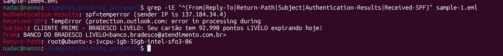
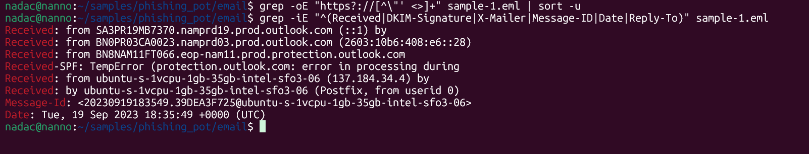
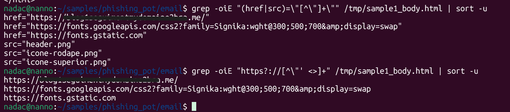
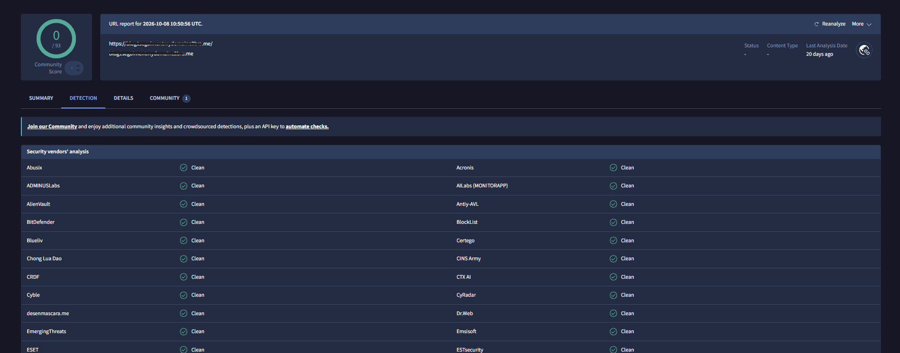
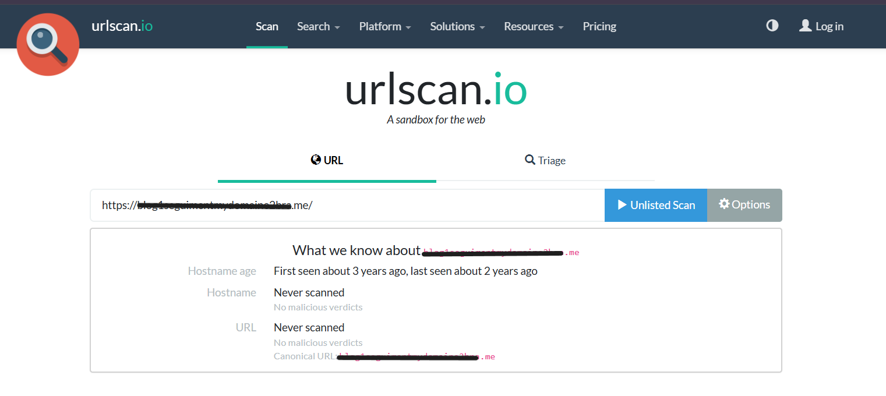
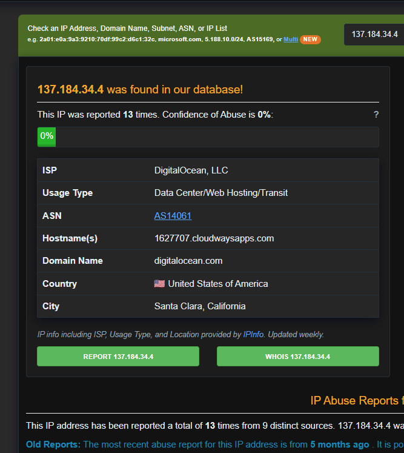

# Analysis #01: Fake Bradesco / Livelo Email

## Summary

| Field | Value |
|---|---|
| **Verdict** | Malicious |
| **Classification** | True Positive (confirmed phishing) |
| **Confidence** | High |
| **Type** | Credential harvesting / reward scam |
| **Source** | Phishing Pot, sample-1 |
| **Email date** | 19 September 2023, 18:35:49 UTC |
| **Language** | Portuguese (Brazil) |
| **MITRE ATTACK** | T1566.002 (Spearphishing Link) |

The email pretends to come from the bank Bradesco and the Livelo rewards program. It says 92,990 points expire today, to push the victim to click a link. It was sent from a rented VPS server, not from the bank, and the link goes to a domain that has nothing to do with the bank.

## Header Analysis

An email has two sender addresses. The `From` line is what the user sees, and anyone can write anything in it, like writing a fake return address on an envelope. The `Return-Path` and the `Received` lines show the real technical path of the message, and they are much harder to fake. So I compare them.

| Header | Value | Why it matters |
|---|---|---|
| From | `BANCO DO BRADESCO LIVELO <banco.bradesco@atendimento[.]com[.]br>` | Shows the bank name, but the domain `atendimento[.]com[.]br` is not the real Bradesco domain (`bradesco.com.br`). The name is only decoration. |
| Return-Path | `root@ubuntu-s-1vcpu-1gb-35gb-intel-sfo3-06` | This is the real sender. It is the `root` account of a server with a default name. A bank never sends customer emails like this. |
| Received (origin) | `by ubuntu-s-1vcpu-1gb-35gb-intel-sfo3-06 (Postfix, from userid 0)` | The message was created on this server by user 0 (root). It is a freshly installed mail server, probably rented by the attacker. |
| Sending IP | `137[.]184[.]34[.]4` | Belongs to DigitalOcean, a cloud hosting company. Anyone can rent a server there. |
| SPF | `temperror` | SPF checks if the sending server is allowed to send for a domain. `temperror` means the check failed to finish, so it tells us nothing. It is not a `pass`. |
| DKIM | No signature | DKIM is a digital signature that proves the email was not changed and comes from the domain. Real banks sign their emails. Here there is none. |
| DMARC | `temperror` | DMARC is the domain's rule based on SPF and DKIM. Same problem: the check could not finish, so it is inconclusive. |
| Reply-To / X-Mailer | Missing | No mail program was used. It was sent by a script or directly from the server. |

**Conclusion of this part:** the visible sender says "bank", but the technical headers say "a rented server run as root". These two do not match, so the sender is fake.

## Body and Link Analysis

The body was HTML encoded in base64 (`Content-Transfer-Encoding: base64`). Base64 turns text into unreadable characters, so a simple `grep` could not see the links. This can also hide content from simple filters. I decoded it with Python's `email` module, without opening the HTML in a browser.

- The text "Clique aqui" and the button "Resgatar Agora" go to the same URL: `hxxps://blog1seguimentmydomaine2bra[.]me/`. This domain has no link with Bradesco or Livelo, and its name is a random mix of words.
- The images use relative paths (`header.png`, etc.), so they cannot load anything. The message "click here to see the images" is only an excuse to make the user click.
- The other URLs (`fonts.googleapis.com`, `fonts.gstatic.com`) are Google fonts and harmless.
- Social engineering tricks: reward (points), urgency ("expirando hoje" = "expiring today"), and a known brand.

## Reputation and Infrastructure

| Source | Result | Why it matters |
|---|---|---|
| VirusTotal (URL) | 0 / 93 | No tool flags it. But the domain is offline, so there is nothing left to scan. This is not proof that it is safe. |
| urlscan.io | First seen ~3 years ago, last seen ~2 years ago, now does not resolve (DNS error) | The domain was active for about a year, then disappeared. Typical for throwaway phishing domains. |
| whois | Domain not found | The domain no longer exists, so I cannot get its creation date. |
| AbuseIPDB (IP) | 13 reports (from Dec 2024), abuse confidence 0%, DigitalOcean AS14061 | The reports are more than a year after the email. The IP was probably given to another customer since then, so today's reputation says little about 2023. |

## IOCs (defanged)

IOCs are written in a "defanged" way (`[.]` and `hxxps`) so nobody can click them by mistake.

| Type | Value | Context |
|---|---|---|
| Domain | `blog1seguimentmydomaine2bra[.]me` | Target of the button and link |
| URL | `hxxps://blog1seguimentmydomaine2bra[.]me/` | Phishing page (offline) |
| IP | `137[.]184[.]34[.]4` | Sending server (DigitalOcean, SFO3) |
| Hostname | `ubuntu-s-1vcpu-1gb-35gb-intel-sfo3-06` | Sender's Postfix hostname |
| Email | `banco.bradesco@atendimento[.]com[.]br` | Spoofed sender |
| Email | `root@ubuntu-s-1vcpu-1gb-35gb-intel-sfo3-06` | Return-Path |
| Message-ID | `20230919183549.39DEA3F725@ubuntu-s-1vcpu-1gb-35gb-intel-sfo3-06` | Message identifier |

## Verdict

**Malicious, True Positive, high confidence.** The verdict comes from the headers and the content, not from reputation tools:
- the message was created by `root` on a rented server with a default hostname
- the visible sender is fake and its domain is not Bradesco's
- no DKIM signature, and SPF and DMARC could not be checked
- the link goes to a domain unrelated to the bank
- reward + urgency bait

## Recommended Actions

1. Block the domain, URL and sending IP on the mail gateway and proxy.
2. Delete the email from all mailboxes.
3. If a user clicked: reset passwords, revoke sessions, watch bank accounts and warn the bank.
4. Report to Signal Spam and phishing-initiative.fr.
5. Train users about "points expiring today" offers.

## Limits of the Analysis

- The sample is from September 2023. The phishing page is offline, so I could not see its content.
- The goal (stealing credentials or card data) is deduced from the email, not confirmed by the page.
- The reputation tools (VirusTotal 0/93, AbuseIPDB 0%) gave false negatives: they said "clean" for a malicious email, because the domain is deleted and the IP was reassigned. They do not change the verdict.
- This email has no attachment.