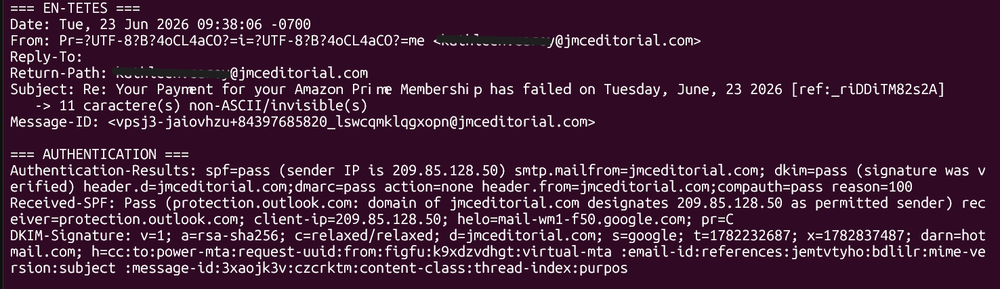
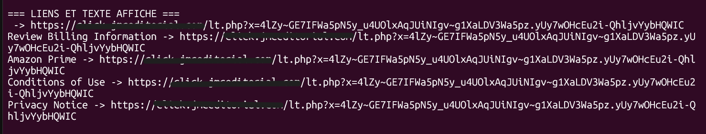
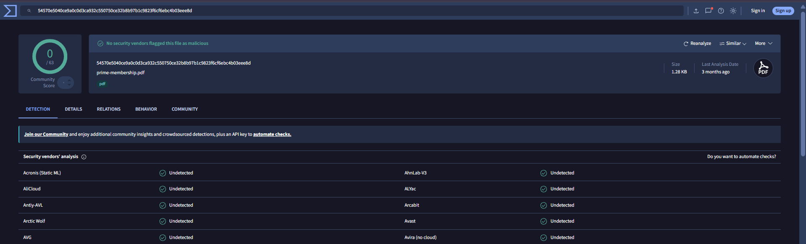
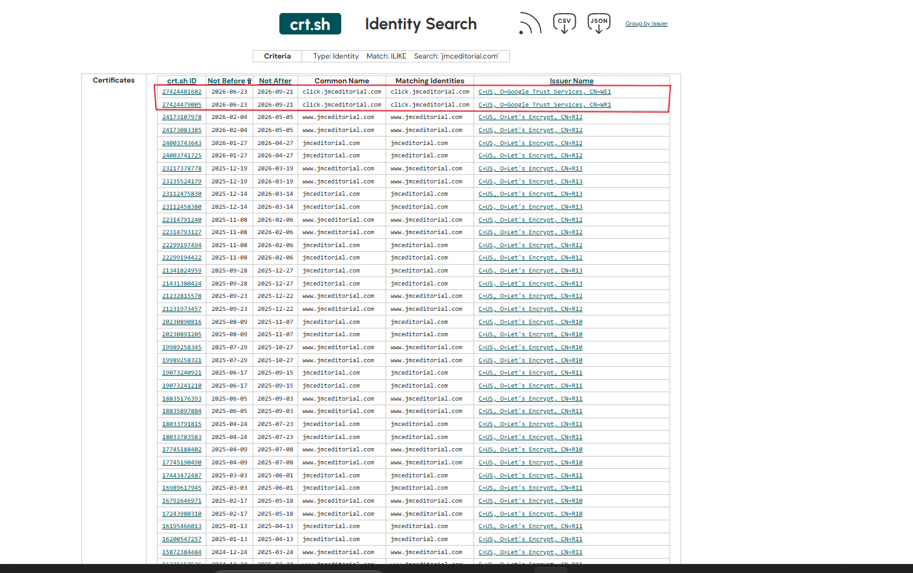

# Analysis #02: Fake Amazon Prime Email (Payment Failed)

## Summary

| Field | Value |
|---|---|
| **Verdict** | Malicious |
| **Classification** | True Positive (confirmed phishing) |
| **Confidence** | High |
| **Type** | Credential harvesting / card data theft (deduced) |
| **Source** | Phishing Pot, sample-10838 |
| **Email date** | 23 June 2026, 09:38:06 -0700 (16:38 UTC) |
| **Language** | English |
| **MITRE ATTACK** | T1566.002, T1036, T1027 |

The email says the Amazon Prime renewal failed and asks the user to "review billing information". **SPF, DKIM and DMARC all pass.** This is the main lesson of this case: a passed authentication check does not mean the email is safe.

## Header Analysis

SPF, DKIM and DMARC only check one thing: does the email really come from the domain written in the sender address? They do not check if that domain is honest. Here the attacker sends from a domain they control, so all checks pass, even if the email pretends to be Amazon.

| Header | Value | Why it matters |
|---|---|---|
| From | `Prime <[name hidden]@jmceditorial[.]com>` | The display name says "Prime", but the real address is on `jmceditorial[.]com`, an editorial company with no link to Amazon. |
| Display name | Contains U+200B and U+180E | These are invisible characters hidden inside the word "Prime". They break the word for spam filters that look for brand names. |
| Return-Path | Same as From | The technical sender is the same as the visible one. |
| Reply-To | Empty | Nothing special here. |
| Subject | `Re: Your Payment for your Amazon Prime Membership has failed ... [ref:_riDDiTM82s2A]` | 11 invisible characters. The fake "Re:" makes it look like an answer to an old conversation. The fake reference number makes it look official. |
| SPF | `pass` (jmceditorial[.]com) | The sending server is allowed to send for `jmceditorial[.]com`. This says nothing about Amazon. |
| DKIM | `pass` (d=jmceditorial[.]com, s=google) | The email is signed by that domain. The domain uses Google Workspace. |
| DMARC | `pass` (action=none), `compauth=pass` | Same: the email matches its own domain. |
| Entry into the network | `smtp.gmail.com`, ESMTPSA, from `89[.]145[.]161[.]106` | The sender logged in to Gmail servers (authenticated session) from a rented cloud server, with a random hostname. |
| Google relay | `209[.]85[.]128[.]50` | A real Google server that only passed the message on. **Do not block it.** |

**Conclusion of this part:** the technical checks are clean, but the sender domain has nothing to do with Amazon. The authentication proves who sent it, not that it is honest.

## Body and Link Analysis

- The text is generic ("Dear Customer"). A real Amazon email uses your name.
- Invisible characters are inside **almost every word**, not only brand names. The goal is probably to break keyword detection in spam filters.
- The footer says "© 2026 Amazon Prime, Inc." This company does not exist. The real name is Amazon.com, Inc.
- **All 5 links** ("Review Billing Information", "Amazon Prime", "Conditions of Use", "Privacy Notice" and one link without text) go to the same tracking URL: `hxxps://click[.]jmceditorial[.]com/lt[.]php?x=...`. A real Amazon email would send "Conditions" and "Privacy" to `amazon.com`. Here even those links are used to track the click.
- The hidden HTML data (not visible to the victim) shows the template was copied from a fake **Proton Mail** email (`<title>You have 1 new message(s) in your Proton Mail account</title>`). `mail.proton.me` is only text in the metadata, not a link. A leftover `-->` shows the template was edited quickly.

**Conclusion of this part:** one hidden destination behind five different texts, a reused template, and a made-up company name.

## Attachment

| Field | Value |
|---|---|
| Name | `prime-membership.pdf` |
| Size | 1,309 bytes |
| SHA256 | `54570e5040ce9a0c0d3ca932c550750ce32b8b97b1c9823f6cf6ebc4b03eee8d` |
| Content | Empty page (`/Length 0`) |
| Active objects | `/URI`, `/JS`, `/JavaScript`, `/OpenAction`, `/Launch`, `/EmbeddedFile`: all at 0 |
| Created with | Pdfcrowd.com (HTML to PDF converter), 27 April 2026 |
| VirusTotal | 0 / 63 |

The PDF is not dangerous by itself. It is probably a **decoy**: it makes the email look like it has an invoice, and it changes the message fingerprint for filters. I read the file in memory only. It was never opened.

## Reputation and Infrastructure

| Source | Result | Why it matters |
|---|---|---|
| AbuseIPDB (`89[.]145[.]161[.]106`) | 0 reports, Exoscale Open Cloud FRA1, AS61098, Frankfurt | A rented cloud IP with no reports. Inconclusive. |
| whois `jmceditorial[.]com` | No match | The domain is not registered today. |
| DNS | `NXDOMAIN` (domain and `click.` subdomain) | The infrastructure is offline. |
| urlscan.io (`click.`) | First seen ~4 months ago, last seen ~2 months ago, never scanned | Matches the date of the email. |
| crt.sh | Let's Encrypt certificates for the main domain since December 2024. `click.jmceditorial[.]com` appears on 23 June 2026 (Google Trust Services). | The domain is old, but the tracking subdomain was created on the day of the attack. |
| Search in Phishing Pot | The domain appears only in this sample. No match for the Proton Mail template (simple text search, only unencoded bodies). | No other emails from the same campaign were found. |

**Hypothesis (not proven):** the domain existed since at least late 2024. The attacker may have taken control of it (hacked Google Workspace or DNS) or taken it after it expired, then created the `click.` subdomain on 23 June 2026. This would explain the three `pass` results. The data cannot confirm which one is true.

## IOCs (defanged)

IOCs are written in a "defanged" way (`[.]` and `hxxps`) so nobody can click them by mistake.

| Type | Value | Context |
|---|---|---|
| Domain | `jmceditorial[.]com` | Sender domain (old, probably hijacked) |
| Subdomain | `click[.]jmceditorial[.]com` | Tracking redirector, created 2026-06-23 |
| URL | `hxxps://click[.]jmceditorial[.]com/lt[.]php?x=...` | Target of all links |
| IP | `89[.]145[.]161[.]106` | Authenticated SMTP client (Exoscale, Frankfurt) |
| Email | `[name hidden]@jmceditorial[.]com` | Sender and Return-Path |
| Message-ID | `vpsj3-jaiovhzu+84397685820_lswcqmklqgxopn@jmceditorial[.]com` | Message identifier |
| SHA256 | `54570e5040ce9a0c0d3ca932c550750ce32b8b97b1c9823f6cf6ebc4b03eee8d` | `prime-membership.pdf` (empty decoy) |
| Characters | U+200B, U+180E | Hidden in the From name and subject |

Do **not** block: `209[.]85[.]128[.]50` (real Google relay).

## MITRE ATTACK Techniques

- **T1566.002**: Spearphishing Link (all links go to the tracker)
- **T1036**: Masquerading (pretends to be Amazon Prime)
- **T1027**: Obfuscated Files or Information (invisible characters to avoid filters)

The empty PDF does not justify T1566.001: it has no payload and no link.

## Verdict

**Malicious, True Positive, high confidence.** The verdict is based on:
- a sender domain unrelated to Amazon, with the display name "Prime"
- invisible characters in the name, subject and body
- "Conditions" and "Privacy" links redirected to a tracker
- a template copied from a fake Proton Mail email
- a fake reference number and a fake "Re:"
- an empty PDF used as a decoy

The three `pass` results do not change this. They only prove that the email really comes from that domain's infrastructure. If someone looked only at authentication, they could wrongly think this email is a false positive.

## Recommended Actions

1. Block the domain `jmceditorial[.]com` and the `click[.]` subdomain on the mail gateway and proxy. Do not block Google IPs.
2. Delete the email from all mailboxes.
3. Add a detection rule for invisible characters (U+200B, U+180E) in the subject and display name.
4. If a user clicked or typed information: reset passwords, warn the bank to block the card, watch for unknown payments.
5. Report to Signal Spam and phishing-initiative.fr.
6. Train users: a passed authentication is not proof of safety, and a "Conditions of Use" link must go to the official site.

## Limits of the Analysis

- The tracker no longer resolves. The final destination and the real goal (stealing credentials or card data) are deduced from the email, not observed.
- The reason for the passed SPF/DKIM/DMARC (hacked or recovered domain) is a hypothesis.
- The reputation tools (VirusTotal 0/63, AbuseIPDB 0%) are inconclusive: the PDF is empty and the cloud IP has no reports.
- The email was read as text only. It was never opened in a browser or a mail client.