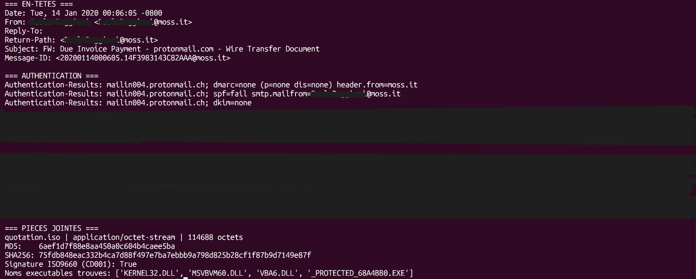
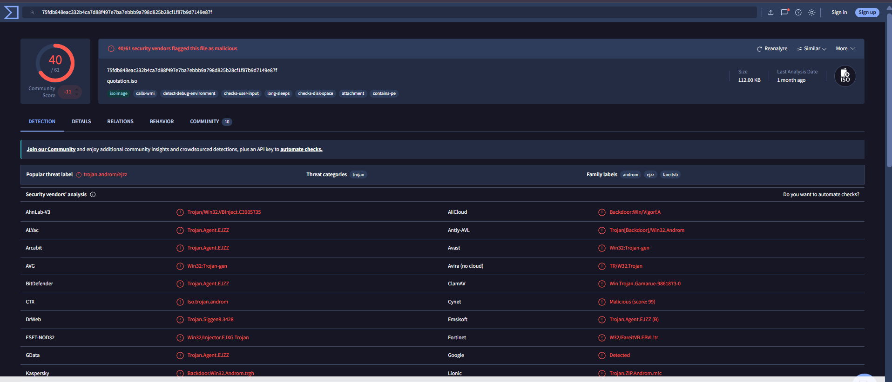
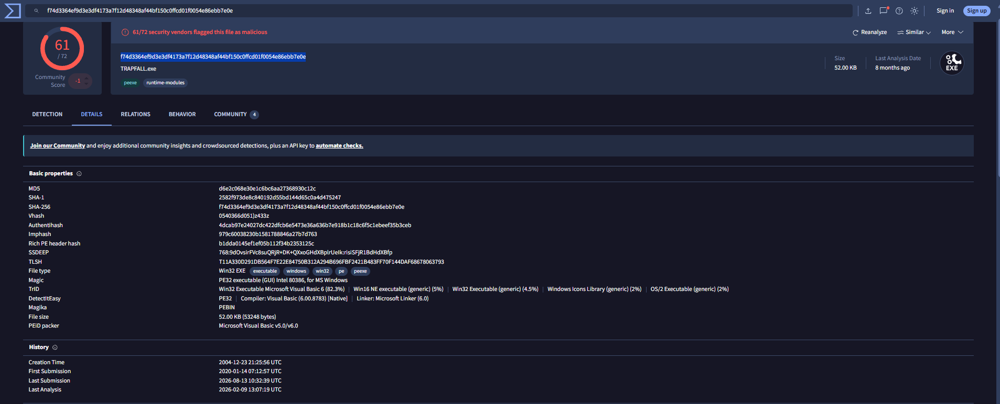

# Analysis #03: Fake Wire Transfer Email with ISO Attachment (Malware)

## Summary

| Field | Value |
|---|---|
| **Verdict** | Malicious |
| **Classification** | True Positive (confirmed malware delivery) |
| **Confidence** | Very high |
| **Type** | Malware delivery by attachment (trojan / dropper) |
| **Source** | Phishing Pot, sample-2571 |
| **Email date** | 14 January 2020, 00:06:05 -0800 (08:06 UTC) |
| **Language** | English |
| **MITRE ATTACK** | T1566.001, T1204.002, T1036, T1027, T1497 |

The email looks like a forwarded conversation about an unpaid invoice, with a "wire transfer slip" attached. The attachment is a disk image, `quotation.iso`, that contains a packed Windows executable written in Visual Basic 6. 61 of 72 antivirus engines flag the executable on VirusTotal. Unlike case #02, **authentication fails here**: the domain of a real Italian company is spoofed.

## Header Analysis

| Header | Value | Why it matters |
|---|---|---|
| From | `[name hidden] <...@moss[.]it>` | An Italian domain, but the text is in English and the receiver uses ProtonMail. Odd for a real business message. |
| Return-Path | Same as From | The technical sender matches the visible one. |
| Reply-To | Empty | Nothing special here. |
| Subject | `FW: Due Invoice Payment - protonmail.com - Wire Transfer Document` | The fake "FW:" makes it look like a forwarded conversation. Invoice and payment topics create pressure. |
| SPF | `fail` (smtp.mailfrom on moss[.]it) | The sending IP is **not allowed** to send for this domain. This is a strong sign of spoofing. |
| DKIM | `none` | No signature, so nothing proves the email really comes from the domain. |
| DMARC | `none (p=none)` | The domain has a policy that does nothing. It does not ask receivers to reject fake emails, so spoofing is easy. |
| Received | One hop only: `from moss.it (unknown [213[.]227[.]154[.]65])` | The server says it is `moss.it`, but `unknown` means the reverse DNS of the IP does not confirm this name. |

**Conclusion of this part:** the email claims to come from `moss[.]it`, but the sending IP is not allowed to send for it. The sender is spoofed.

## Body Analysis

- The tone is professional: "confirm receipt of the payment", "please reconfirm your bank details on the attached slip".
- It includes a fake forwarded conversation ("Purchases", "hr", "Cc") with invoices "to be paid urgently". This makes the message look like a real business thread.
- The only link in the HTML is a `w3.org` DTD, which is harmless. The attack depends fully on the attachment.
- Social engineering: financial urgency, payment topic, fake conversation.

**Conclusion of this part:** the text has one goal, to make the user open the attachment.

## Attachment: `quotation.iso`

| Field | Value | Why it matters |
|---|---|---|
| Type | ISO9660 disk image (`CD001` signature checked) | It is a real ISO, not a renamed file. |
| Size | 114,688 bytes | Small. It holds one small program. |
| MD5 | `6aef1d7f88e8aa450a0c604b4caee5ba` | File identifier. |
| SHA256 | `75fdb848eac332b4ca7d88f497e7ba7ebbb9a798d825b28cf1f87b9d7149e87f` | File identifier, used to search VirusTotal. |
| VirusTotal | **40 / 61**, label `trojan.androm/ejzz` | Many engines flag it as a trojan. |
| Behavior (VT tags) | `detect-debug-environment`, `long-sleeps`, `checks-user-input`, `checks-disk-space`, `calls-wmi`, `contains-pe` | The malware checks if it is being analyzed, waits a long time, and looks for a real user. These are sandbox evasion tricks. |

Attackers use ISO files because some filters inspect `.exe` files but do not look inside disk images. I **did not mount or extract** the ISO. I found the executable name by searching strings in the raw bytes, then VirusTotal confirmed it in the *Bundled Files* section.

## Executable Inside the ISO

| Field | Value | Why it matters |
|---|---|---|
| Names seen | `_PROTECTED_68A4BB0.EXE` (strings in the ISO), `/MAKAVE (2)_PROTECTED_68A4BB0.EXE` (Bundled Files), `TRAPFALL.exe` (name on VT page) | The same file has different names. This is common (name in the archive, name used by the first uploader). |
| Size | 53,248 bytes | |
| MD5 | `d6e2c068e30e1c6bc6aa27368930c12c` | |
| SHA-1 | `2582f973de8c840192d55bd144d65c0a4d475247` | |
| SHA256 | `f74d3364ef9d3e3df4173a7f12d48348af44bf150c0ffcd01f0054e86ebb7e0e` | |
| VirusTotal | **61 / 72**, categories `trojan`, `dropper`, families `androm`, `ejzz`, `fareitvb` | A dropper installs or downloads other malware. |
| Compiler | Microsoft Visual Basic 6.00 (confirmed by PEiD, TrID and the DLLs `MSVBVM60.DLL`, `VBA6.DLL`) | Old language, often used by loaders and password stealers. |
| Compile timestamp | 2004-12-23, **not reliable** | A 2004 program sent in 2020 is not realistic. The date was faked or copied. |
| First VT submission | 14 January 2020, same day as the email | The file was new when the attack started. |

The antivirus engines do not agree on one family (Andromeda, Fareit/Pony, generic injector). This is common for a packed VB6 loader. My careful conclusion: **a packed VB6 trojan, dropper or injector type, probable family Andromeda or Fareit depending on the engine.**

## Reputation and Infrastructure

| Source | Result | Why it matters |
|---|---|---|
| AbuseIPDB (`213[.]227[.]154[.]65`) | 0 reports, LeaseWeb Netherlands (AS60781), Amsterdam | A rented cloud server with no reports. Inconclusive. |
| whois `moss[.]it` | Domain created in 2000, registered by a real Italian company | An old and legitimate domain that was **spoofed**, not hijacked. |
| Search in Phishing Pot | Domain and IP appear only in this sample | No other emails from the same campaign were found (simple text search). |

The email looks Italian, but it was sent from a Dutch IP unrelated to the domain. This is why SPF fails.

## IOCs (defanged)

IOCs are written in a "defanged" way (`[.]` and `hxxps`) so nobody can click them by mistake.

| Type | Value | Context |
|---|---|---|
| Domain | `moss[.]it` | Spoofed domain (real company) |
| IP | `213[.]227[.]154[.]65` | Sending server (LeaseWeb, Amsterdam) |
| File | `quotation.iso` | Attachment |
| SHA256 | `75fdb848eac332b4ca7d88f497e7ba7ebbb9a798d825b28cf1f87b9d7149e87f` | ISO |
| MD5 | `6aef1d7f88e8aa450a0c604b4caee5ba` | ISO |
| File | `_PROTECTED_68A4BB0.EXE` | Executable inside the ISO |
| SHA256 | `f74d3364ef9d3e3df4173a7f12d48348af44bf150c0ffcd01f0054e86ebb7e0e` | Executable |
| MD5 | `d6e2c068e30e1c6bc6aa27368930c12c` | Executable |
| Message-ID | `20200114000605.14F3983143C82AAA@moss[.]it` | Message identifier |

## MITRE ATTACK Techniques

- **T1566.001**: Spearphishing Attachment (ISO)
- **T1204.002**: User Execution, Malicious File (the victim must open the ISO and run the file)
- **T1036**: Masquerading (name `quotation`, fake invoice)
- **T1027**: Obfuscated Files or Information (packed executable)
- **T1497**: Virtualization/Sandbox Evasion (from VirusTotal tags)

## Verdict

**Malicious, True Positive, very high confidence.**
- ISO attachment with an executable flagged by 61/72 engines
- SPF `fail`, no DKIM, DMARC without a real policy
- a legitimate domain is spoofed, and the IP has no link with it
- fake "FW:" and urgent payment topic
- packed executable with sandbox evasion behavior

## Recommended Actions

1. Block the SHA256 hashes of the ISO and the executable on the EDR and mail gateway.
2. Block the sending IP and filter `.iso`, `.img` and encrypted archive attachments at the gateway.
3. Delete the email from all mailboxes.
4. If a user opened the ISO or ran the file: isolate the computer, run an EDR scan, reset all passwords typed or stored on it, revoke sessions, watch the accounts (the family is focused on stealing credentials).
5. Warn the spoofed company (`moss[.]it`) and suggest DMARC `quarantine` or `reject`.
6. Report the sample and the IP, and train users about "wire transfer slips" received as attachments.

## Limits of the Analysis

- The ISO was never mounted and the executable was never extracted or run. The behavior comes from VirusTotal tags and classification.
- The exact malware family is uncertain because engines disagree.
- The compile timestamp (2004) is not reliable.
- The LeaseWeb IP has no reports on AbuseIPDB: inconclusive.
- There is no link to analyze. The attack depends only on the attachment.